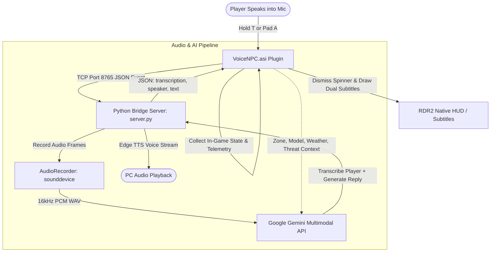

# VoiceNPC: Real-Time AI NPC Conversations for Red Dead Redemption 2

[](https://www.microsoft.com/windows)
[](https://en.wikipedia.org/wiki/C%2B%2B17)
[](https://www.python.org/)
[](http://www.dev-c.com/rdr2/scripthookrdr2/)
[](https://ai.google.dev/)
[](https://github.com/rany2/edge-tts)

**VoiceNPC** brings living, unscripted artificial intelligence to **Red Dead Redemption 2**. Instead of choosing from canned dialogue options, you can speak naturally into your microphone to any character across the frontier. 

Every NPC perceives who they are, where they stand, what the weather is like, and whether Arthur Morgan has a revolver trained on their head—responding dynamically with 1899 period-accurate dialogue, realistic vocal synthesis, and native game UI integration.

---

## Table of Contents

- [Key Features](#key-features)
- [How It Works](#how-it-works)
- [Project Architecture](#project-architecture)
- [Prerequisites](#prerequisites)
- [Installation & Setup](#installation--setup)
  - [1. Configure the Python AI Bridge](#1-configure-the-python-ai-bridge)
  - [2. Install the RDR2 ASI Mod](#2-install-the-rdr2-asi-mod)
- [In-Game Controls & Gameplay](#in-game-controls--gameplay)
- [Building from Source](#building-from-source)
- [Project Structure](#project-structure)
- [Troubleshooting & FAQ](#troubleshooting--faq)
- [Disclaimer](#disclaimer)

---

## Key Features

### 🎙️ Direct Voice Interaction (Push-to-Talk)
* Hold <kbd>T</kbd> on keyboard or <kbd>A</kbd> / <kbd>Cross</kbd> on controller to talk directly to any NPC in the world.
* Speak in your natural tone, ask questions, make threats, or converse casually.

### 🧠 Deep Multimodal Engine Awareness
NPCs do not generate generic chatbot responses. The mod hooks into the RDR2 engine and provides real-time situational telemetry to Google Gemini:
* **True Occupations & Identifies**: Over 70+ character models and relationship groups mapped to exact roles—Sheriff Curtis Malloy, Valentine saloon bartenders, Rhodes deputies, local shopkeepers, and miners.
* **Map & Location**: Knows exact towns and territories via Jenkins hashes (Valentine, Saint Denis, Strawberry, Colter, Bayou Nwa, Grizzlies, etc.).
* **Immediate Threat & Posture**: NPCs react immediately if Arthur is aiming a gun at them, mounted on horseback looking down, or if Arthur has an active Wanted level.
* **Physical State & Context**: Detects if the NPC is hogtied on the ground, injured, fleeing, inside a building, driving a wagon, or doing chores.
* **Atmosphere & Environment**: Aware of in-game time of day, rainstorms, and freezing blizzards.

### 🔊 Fast Neural Speech Synthesis (Edge TTS)
* Streams natural character voices tuned with custom pitch and pacing tailored for frontier men and women.
* Runs on CPU/network without hogging GPU resources needed for the game.

### 🤠 Authentic 1899 Native RDR2 UI
* **Dynamic Interaction Prompt**: Adds a native "Speak" prompt to the NPC target widget without overriding vanilla game options.
* **Cylinder Busy Spinner**: Shows the authentic spinning revolver cylinder HUD element with *"Thinking..."* while the AI processes your speech.
* **Period Dialogue Subtitles**: Dual-line subtitle display showing:
  * **Arthur's Speech (STT)**: Rendered above in soft ice-blue.
  * **NPC Reply**: Rendered below with yellow speaker tag and white dialogue text.
* **Vanilla Friendly**: Standard Greet (<kbd>X</kbd>/<kbd>R</kbd>), Antagonize (<kbd>B</kbd>/<kbd>F</kbd>), and Rob (<kbd>Y</kbd>/<kbd>E</kbd>) remain 100% untouched and functional.

---

## How It Works



1. **Press & Hold**: When you hold the voice button while facing/targeting an NPC, `VoiceNPC.asi` tells `server.py` to begin recording your microphone audio and freezes Arthur's canned ambient lines.
2. **Release Button**: Upon release, audio capture stops. The ASI triggers the native revolving cylinder busy spinner.
3. **AI Inference**: The audio bytes and detailed game state (threat levels, location, model occupation, weather) are sent to Google Gemini in a single multimodal query.
4. **Subtitles & Voice**: Gemini transcribes what you said and crafts an authentic 1899 response. The Python server streams speech to your audio output via Edge TTS while dispatching the subtitle packet back to the game over TCP.

---

## Project Architecture

The project consists of two coordinated components:

1. **`rdr2-integration/` (C++ ScriptHook Plugin)**
   * Built as `VoiceNPC.asi`.
   * Integrates with ScriptHookRDR2 natives (`ENTITY`, `PED`, `PLAYER`, `HUD`, `ZONE`, `MISC`, `AUDIO`).
   * Manages thread-safe asynchronous TCP client communication, button input checks (XInput + DirectInput), coordinate calculations, and native HUD drawing.

2. **`AI/` (Python AI Bridge Server)**
   * Runs locally on `127.0.0.1:8765`.
   * Captures microphone audio using `sounddevice` and `soundfile`.
   * Interfaces with the official `google-genai` SDK using high-speed flash models (`gemini-3.5-flash-lite`).
   * Handles 1899 persona prompting, anti-cliché filters, and prompt formatting.
   * Renders instant vocal audio through `edge-tts`.

---

## Prerequisites

Before starting, make sure you have:

- **Red Dead Redemption 2** (PC version: Steam, Rockstar Games Launcher, or Epic Games Store).
- [ScriptHookRDR2 by Alexander Blade](http://www.dev-c.com/rdr2/scripthookrdr2/) (`ScriptHookRDR2.dll` and `dinput8.dll` placed in your game root directory).
- **Python 3.10+** (64-bit) installed with `python` added to your system `PATH`.
- A free **Google Gemini API Key** (obtainable from [Google AI Studio](https://aistudio.google.com/)).
- A working **Microphone** and **Speakers/Headphones** set as your default Windows audio devices.

---

## Installation & Setup

### 1. Configure the Python AI Bridge

1. Open the [`AI/`](AI) directory:
   ```powershell
   cd C:\Games\Mods\RDR2\VoiceNPC\AI
   ```
2. Run the automated installer by double-clicking [`install.bat`](AI/install.bat) (or run via terminal):
   ```cmd
   install.bat
   ```
   *This creates an isolated virtual environment (`.venv`), installs all required packages, and creates `.env`.*
3. Open [`AI/.env`](AI/.env) in any text editor and paste your Gemini API key:
   ```env
   GEMINI_API_KEY=your_gemini_api_key_here
   ```
4. Start the AI bridge server by running [`start.bat`](AI/start.bat):
   ```cmd
   start.bat
   ```
   *Keep this command window running while playing RDR2.*

### 2. Install the RDR2 ASI Mod

1. Copy the precompiled [`VoiceNPC.asi`](rdr2-integration/VoiceNPC.asi) from the `rdr2-integration/` directory into your main Red Dead Redemption 2 game folder (where `RDR2.exe` is located):
   ```text
   C:\Program Files (x86)\Steam\steamapps\common\Red Dead Redemption 2\VoiceNPC.asi
   ```
2. Verify that `ScriptHookRDR2.dll` and `dinput8.dll` are also present in your game folder.
3. Launch Red Dead Redemption 2!

---

## In-Game Controls & Gameplay

| Action | Keyboard | Controller | Details |
| :--- | :--- | :--- | :--- |
| **Speak to NPC** | **Hold <kbd>T</kbd>** | **Hold <kbd>A</kbd> / <kbd>Cross</kbd>** | Look at / target an NPC and hold while speaking into mic. Release when finished. |
| **Vanilla Greet** | <kbd>R</kbd> | <kbd>X</kbd> (Square) | Standard in-game greet interaction (untouched). |
| **Vanilla Antagonize** | <kbd>F</kbd> | <kbd>B</kbd> (Circle) | Standard in-game antagonize interaction (untouched). |
| **Vanilla Rob / Aim** | Right-Click / <kbd>E</kbd> | <kbd>LT</kbd> + <kbd>Y</kbd> (Triangle) | Standard in-game hold-up interaction. |

### Gameplay Situations to Try:
* **Town Folklife**: Visit the Valentine Saloon or Saint Denis gunsmith. Walk up to the bartender or owner and ask about recent gossip, drinks, or local bounties.
* **Stick-ups & Holdups**: Draw your weapon and aim it at an NPC before speaking. They will panic, raise their hands, or plead according to their temperament.
* **Lasso & Hogtie**: Hogtie an outlaw or civilian with your lasso, stand over them, and interrogate them. They will react directly to being bound in the dirt.
* **Rough Weather**: Talk to travelers in the middle of a blizzard near Mount Hagen or during a torrential downpour in the Bayou.

---

## Building from Source

If you want to modify the C++ ASI integration:

### Requirements:
- **Visual Studio 2022** (with *Desktop development with C++* and MSVC v143 toolset).
- **ScriptHookRDR2 SDK** (headers and `ScriptHookRDR2.lib`).

### Build Steps:
1. Open [`rdr2-integration/build.bat`](rdr2-integration/build.bat) in an editor and verify your paths:
   ```cmd
   set "VS_PATH=C:\Program Files (x86)\Microsoft Visual Studio\2022\BuildTools"
   set "SDK_INC=C:\Games\Mods\RDR2\SDK\SDK\inc"
   set "SDK_LIB=C:\Games\Mods\RDR2\SDK\SDK\lib"
   set "RDR2_DIR=C:\Program Files (x86)\Steam\steamapps\common\Red Dead Redemption 2"
   ```
2. Run `build.bat`:
   ```cmd
   cd rdr2-integration
   build.bat
   ```
3. The script compiles `main.cpp` using `/std:c++17` and automatically copies `VoiceNPC.asi` into your RDR2 folder upon successful compilation.

---

## Project Structure

```text
VoiceNPC/
├── README.md                      # Primary project documentation
├── AI/                            # Python AI Bridge Server
│   ├── .env                       # API credentials (GEMINI_API_KEY)
│   ├── .env.example               # Example template for credentials
│   ├── ai_agent.py                # Gemini multimodal inference & system prompts
│   ├── audio_recorder.py          # Real-time microphone audio capture (sounddevice)
│   ├── install.bat                # One-click virtualenv installer
│   ├── ped_models.py              # Hash registry for NPC roles & occupations
│   ├── README.md                  # AI bridge specific documentation
│   ├── requirements.txt           # Python dependencies
│   ├── server.py                  # TCP server listening on 127.0.0.1:8765
│   ├── start.bat                  # One-click bridge startup script
│   ├── tts_manager.py             # Frontier voice synthesis (edge-tts)
│   └── zones.py                   # RDR2 zone hash to town name mapper
└── rdr2-integration/              # C++ ScriptHookRDR2 Mod
    ├── build.bat                  # MSVC compilation & deployment script
    ├── main.cpp                   # Mod core: TCP client, natives, HUD, controls
    └── VoiceNPC.asi               # Precompiled RDR2 plugin binary
```

---

## Troubleshooting & FAQ

### 1. The server says "Connected to RDR2", but NPCs don't answer
* Ensure your microphone is enabled and set as the **Default Recording Device** in Windows Sound Settings.
* Check that your Gemini API key in [`AI/.env`](AI/.env) is valid and has active quota.
* Look at the Python console window: you should see Arthur's transcribed words logged in real time.

### 2. NPCs answer with text subtitles, but there is no sound
* Edge TTS plays through the Windows **Default Playback Device**. Make sure your game audio and default sound output match.
* Ensure your PC has an active internet connection, as Edge TTS streams neural audio online.

### 3. The revolving "Thinking..." spinner doesn't disappear
* A built-in 10-second safety timeout will automatically dismiss the spinner if communication is delayed or dropped.
* Check the Python console to verify whether Gemini encountered a rate limit (HTTP 429) or network timeout.

### 4. Controller 'A' button causes Arthur to jump or sprint
* The mod automatically calls `PAD::DISABLE_CONTROL_ACTION` while interacting so that jumping or sprinting is suppressed while speaking to an NPC. Ensure you are targeting an NPC when holding <kbd>A</kbd>.

---

## Disclaimer

* This is an unofficial, non-commercial modification designed exclusively for **single-player** mode.
* Do not attempt to use ScriptHook or mods in Red Dead Online, as this violates Rockstar Games' Terms of Service.
* Red Dead Redemption 2 is a registered trademark of Rockstar Games and Take-Two Interactive. This project is not affiliated with or endorsed by Rockstar Games.
