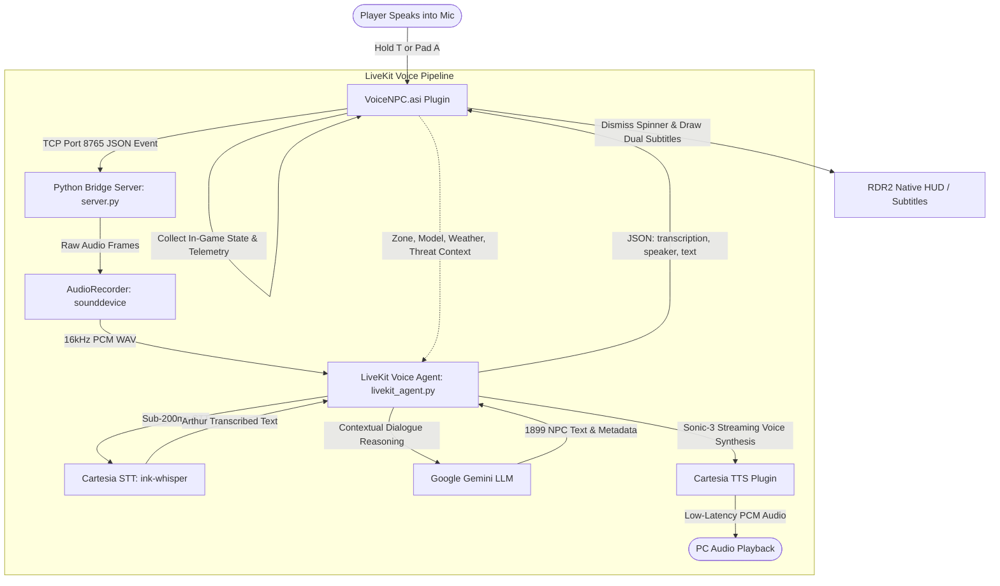

# VoiceNPC: Real-Time AI NPC Conversations for Red Dead Redemption 2

[](https://www.microsoft.com/windows)
[](https://en.wikipedia.org/wiki/C%2B%2B17)
[](https://www.python.org/)
[](http://www.dev-c.com/rdr2/scripthookrdr2/)
[](https://livekit.io/)
[](https://cartesia.ai/)
[](https://ai.google.dev/)

**VoiceNPC** brings living, unscripted artificial intelligence to **Red Dead Redemption 2**. Instead of choosing from canned dialogue options, you can speak naturally into your microphone to any character across the frontier. 

Every NPC perceives who they are, where they stand, what the weather is like, and whether Arthur Morgan has a revolver trained on their head—responding dynamically with 1899 period-accurate dialogue, sub-200ms speech-to-text and voice synthesis via **Cartesia**, and full voice agent orchestration via **LiveKit**.

---

## Table of Contents

- [Key Features](#key-features)
- [How It Works](#how-it-works)
- [Project Architecture](#project-architecture)
- [Prerequisites](#prerequisites)
- [Installation & Setup](#installation--setup)
  - [1. Configure the Python AI Bridge](#1-configure-the-python-ai-bridge)
  - [2. Install the RDR2 ASI Mod](#2-install-the-rdr2-asi-mod)
- [In-Game Controls & Gameplay](#in-game-controls--gameplay)
- [Building from Source](#building-from-source)
- [Project Structure](#project-structure)
- [Troubleshooting & FAQ](#troubleshooting--faq)
- [Disclaimer](#disclaimer)

---

## Key Features

### 🎙️ Direct Voice Interaction (Push-to-Talk)
* Hold <kbd>T</kbd> on keyboard or <kbd>A</kbd> / <kbd>Cross</kbd> on controller to talk directly to any NPC in the world.
* Speak in your natural tone, ask questions, make threats, or converse casually.

### ⚡ Ultra-Fast Speech-to-Text (Cartesia ink-whisper)
* Transcribes Arthur Morgan's spoken microphone audio in ~0.15 seconds with extreme precision, delivering instantaneous STT tokens into the LiveKit pipeline.

### 🤖 LiveKit Voice Agent Pipeline
* Built on top of **LiveKit Agents** (`livekit-agents`), providing an extensible real-time conversational agent loop with turn detection, state tracking, and streaming audio.

### 🧠 Deep Multimodal Engine Awareness (Google Gemini)
NPCs do not generate generic chatbot responses. The mod hooks into the RDR2 engine and provides real-time situational telemetry to Google Gemini:
* **True Occupations & Identifies**: Over 70+ character models and relationship groups mapped to exact roles—Sheriff Curtis Malloy, Valentine saloon bartenders, Rhodes deputies, local shopkeepers, and miners.
* **Map & Location**: Knows exact towns and territories via Jenkins hashes (Valentine, Saint Denis, Strawberry, Colter, Bayou Nwa, Grizzlies, etc.).
* **Immediate Threat & Posture**: NPCs react immediately if Arthur is aiming a gun at them, mounted on horseback looking down, or if Arthur has an active Wanted level.
* **Physical State & Context**: Detects if the NPC is hogtied on the ground, injured, fleeing, inside a building, driving a wagon, or doing chores.
* **Atmosphere & Environment**: Aware of in-game time of day, rainstorms, and freezing blizzards.

### 🔊 Ultra-Low Latency Neural Speech (Cartesia Sonic-3)
* Synthesizes expressive 1899 character voices in under 150ms using Cartesia's state-of-the-art **Sonic-3** voice model.
* Dynamic frontier voice assignment:
  * **Sheriffs & Lawmen**: Deep, authoritative frontier timbre (James / Troy)
  * **Weathered Elders & Miners**: Gruff, gravelly tone (Trevor)
  * **Bankers & Clerks**: Composed, articulate cadence (Clive)
  * **Townswomen & Saloon Workers**: Expressive pioneer and frontier female voices (Darla, Ruth, Jacqueline)

### 🤠 Authentic 1899 Native RDR2 UI
* **Dynamic Interaction Prompt**: Adds a native "Speak" prompt to the NPC target widget without overriding vanilla game options.
* **Cylinder Busy Spinner**: Shows the authentic spinning revolver cylinder HUD element with *"Thinking..."* while the AI processes your speech.
* **Period Dialogue Subtitles**: Dual-line subtitle display showing:
  * **Arthur's Speech (STT)**: Rendered above in soft ice-blue.
  * **NPC Reply**: Rendered below with yellow speaker tag and white dialogue text.
* **Vanilla Friendly**: Standard Greet (<kbd>X</kbd>/<kbd>R</kbd>), Antagonize (<kbd>B</kbd>/<kbd>F</kbd>), and Rob (<kbd>Y</kbd>/<kbd>E</kbd>) remain 100% untouched and functional.

---

## How It Works



1. **Press & Hold**: When you hold the voice button while facing/targeting an NPC, `VoiceNPC.asi` tells `server.py` to begin recording your microphone audio and freezes Arthur's canned ambient lines.
2. **Release Button**: Upon release, audio capture stops. The ASI triggers the native revolving cylinder busy spinner.
3. **LiveKit Voice Agent Loop**:
   * Arthur's audio is transcribed in ~0.15s via **Cartesia STT** (`ink-whisper`).
   * The transcription and detailed game state (threat levels, location, model occupation, weather) are sent to **Google Gemini**.
   * Gemini crafts an authentic 1899 dialogue response matching the NPC's true identity.
   * **Cartesia Sonic-3** synthesizes period-accurate voice audio and streams it to your speakers in real time.
4. **Subtitles**: The Python server dispatches the subtitle packet back to RDR2 over TCP, displaying Arthur's transcribed words and the NPC's response with accurate speaker titles.

---

## Project Architecture

The project consists of two coordinated components:

1. **`rdr2-integration/` (C++ ScriptHook Plugin)**
   * Built as `VoiceNPC.asi`.
   * Integrates with ScriptHookRDR2 natives (`ENTITY`, `PED`, `PLAYER`, `HUD`, `ZONE`, `MISC`, `AUDIO`).
   * Manages thread-safe asynchronous TCP client communication, button input checks (XInput + DirectInput), coordinate calculations, and native HUD drawing.

2. **`AI/` (Python LiveKit AI Bridge Server)**
   * Runs locally on `127.0.0.1:8765`.
   * Coordinates the **LiveKit Agent** pipeline with **Cartesia** (STT & TTS) and **Google Gemini** (LLM).
   * Dynamic Cartesia voice assignment based on NPC model, occupation, and gender.
   * Standalone LiveKit CLI runner available via [`agent.py`](AI/agent.py) (`python agent.py console`).

---

## Prerequisites

Before starting, make sure you have:

- **Red Dead Redemption 2** (PC version: Steam, Rockstar Games Launcher, or Epic Games Store).
- [ScriptHookRDR2 by Alexander Blade](http://www.dev-c.com/rdr2/scripthookrdr2/) (`ScriptHookRDR2.dll` and `dinput8.dll` placed in your game root directory).
- **Python 3.10+** (64-bit) installed with `python` added to your system `PATH`.
- A **Google Gemini API Key** (from [Google AI Studio](https://aistudio.google.com/)).
- A **Cartesia API Key** (from [Cartesia Playground](https://play.cartesia.ai/)).
- A working **Microphone** and **Speakers/Headphones** set as your default Windows audio devices.

---

## Installation & Setup

### 1. Configure the Python AI Bridge

1. Open the [`AI/`](AI) directory:
   ```powershell
   cd C:\Games\Mods\RDR2\VoiceNPC\AI
   ```
2. Run the automated installer by double-clicking [`install.bat`](AI/install.bat) (or run via terminal):
   ```cmd
   install.bat
   ```
   *This creates an isolated virtual environment (`.venv`), installs all required packages (LiveKit Agents, Cartesia, Google GenAI), and creates `.env`.*
3. Open [`AI/.env`](AI/.env) in any text editor and paste your API keys:
   ```env
   GEMINI_API_KEY=your_gemini_api_key_here
   CARTESIA_API_KEY=your_cartesia_api_key_here
   LIVEKIT_URL=wss://your-project.livekit.cloud
   LIVEKIT_API_KEY=your_livekit_api_key_here
   LIVEKIT_API_SECRET=your_livekit_api_secret_here
   ```
4. Start the AI bridge server by running [`start.bat`](AI/start.bat):
   ```cmd
   start.bat
   ```
   *Keep this command window running while playing RDR2.*

### 2. Install the RDR2 ASI Mod

1. Copy the precompiled [`VoiceNPC.asi`](rdr2-integration/VoiceNPC.asi) from the `rdr2-integration/` directory into your main Red Dead Redemption 2 game folder (where `RDR2.exe` is located):
   ```text
   C:\Program Files (x86)\Steam\steamapps\common\Red Dead Redemption 2\VoiceNPC.asi
   ```
2. Verify that `ScriptHookRDR2.dll` and `dinput8.dll` are also present in your game folder.
3. Launch Red Dead Redemption 2!

---

## In-Game Controls & Gameplay

| Action | Keyboard | Controller | Details |
| :--- | :--- | :--- | :--- |
| **Speak to NPC** | **Hold <kbd>T</kbd>** | **Hold <kbd>A</kbd> / <kbd>Cross</kbd>** | Look at / target an NPC and hold while speaking into mic. Release when finished. |
| **Vanilla Greet** | <kbd>R</kbd> | <kbd>X</kbd> (Square) | Standard in-game greet interaction (untouched). |
| **Vanilla Antagonize** | <kbd>F</kbd> | <kbd>B</kbd> (Circle) | Standard in-game antagonize interaction (untouched). |
| **Vanilla Rob / Aim** | Right-Click / <kbd>E</kbd> | <kbd>LT</kbd> + <kbd>Y</kbd> (Triangle) | Standard in-game hold-up interaction. |

---

## Project Structure

```text
VoiceNPC/
├── README.md                      # Primary project documentation
├── AI/                            # Python LiveKit AI Bridge Server
│   ├── .env                       # API credentials (GEMINI, CARTESIA, LIVEKIT)
│   ├── .env.example               # Example template for credentials
│   ├── audio_recorder.py          # Real-time microphone audio capture (sounddevice)
│   ├── install.bat                # One-click virtualenv installer
│   ├── livekit_agent.py           # Core LiveKit Voice Agent pipeline (Cartesia STT -> Gemini -> Cartesia TTS)
│   ├── ped_models.py              # Hash registry for NPC roles & occupations
│   ├── README.md                  # AI bridge specific documentation
│   ├── requirements.txt           # Python dependencies (livekit, cartesia, google-genai)
│   ├── server.py                  # TCP server listening on 127.0.0.1:8765
│   ├── start.bat                  # One-click bridge startup script
│   ├── tts_manager.py             # Frontier voice synthesis (Cartesia Sonic-3)
│   └── zones.py                   # RDR2 zone hash to town name mapper
└── rdr2-integration/              # C++ ScriptHookRDR2 Mod
    ├── build.bat                  # MSVC compilation & deployment script
    ├── main.cpp                   # Mod core: TCP client, natives, HUD, controls
    └── VoiceNPC.asi               # Precompiled RDR2 plugin binary
```

---

## Troubleshooting & FAQ

### 1. The server says "Connected to RDR2", but NPCs don't answer
* Ensure your microphone is enabled and set as the **Default Recording Device** in Windows Sound Settings.
* Check that your Gemini and Cartesia API keys in [`AI/.env`](AI/.env) are valid.
* Look at the Python console window: you should see Arthur's transcribed words logged in real time.

### 2. NPCs answer with text subtitles, but there is no sound
* Cartesia plays through the Windows **Default Playback Device**. Make sure your game audio and default sound output match.
* Ensure your PC has an active internet connection.

### 3. The revolving "Thinking..." spinner doesn't disappear
* A built-in 10-second safety timeout will automatically dismiss the spinner if communication is delayed or dropped.
* Check the Python console to verify whether Gemini or Cartesia encountered a rate limit or timeout.

---

## Disclaimer

* This is an unofficial, non-commercial modification designed exclusively for **single-player** mode.
* Do not attempt to use ScriptHook or mods in Red Dead Online, as this violates Rockstar Games' Terms of Service.
* Red Dead Redemption 2 is a registered trademark of Rockstar Games and Take-Two Interactive. This project is not affiliated with or endorsed by Rockstar Games.
